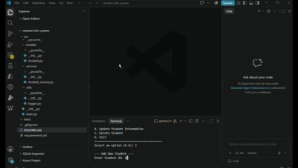

# Student Information System (SIS)

A scalable, cloud-ready Student Information System developed in Python with modular design, JSON-backed data storage, automated logging, and a command-line interface.

---

## 🎥 Demo

